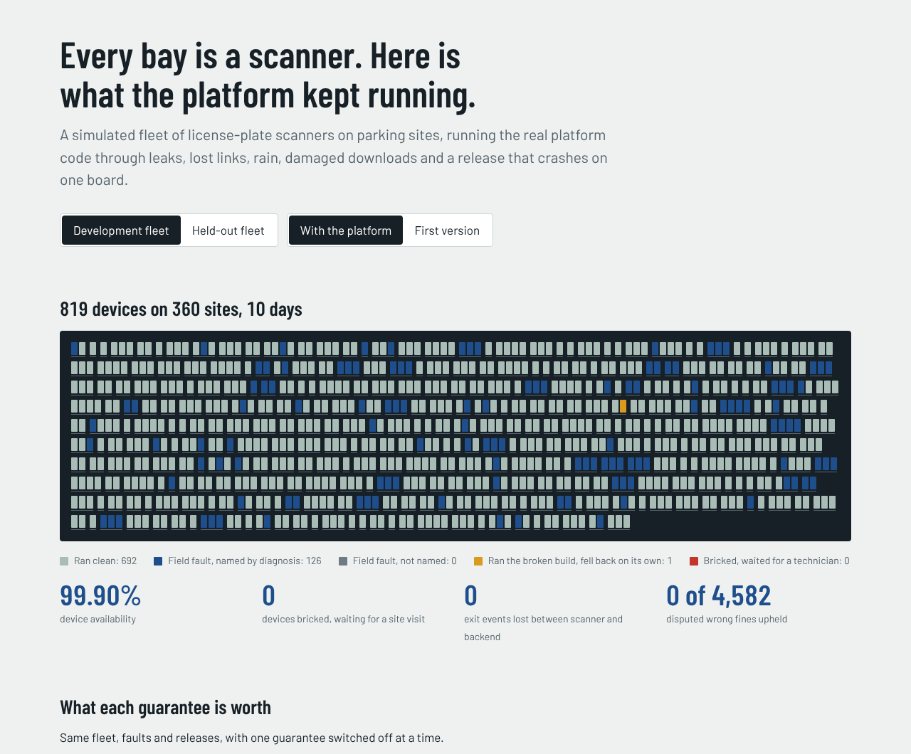

# scanner-fleet-platform

A Python platform layer for a fleet of Linux edge devices, ARM and x86: health monitoring, structured
logging, layered configuration, signed A/B over-the-air updates with automatic fallback, a systemd and
hardware watchdog, MQTT + Protobuf telemetry that waits on the device through LTE outages, and a
hardware abstraction for modems, watchdogs, cameras and AI accelerators. Every device type runs the
same platform; applications build on its interfaces.

It is built for unattended license-plate scanners on parking sites: thousands of devices outdoors,
on cellular links, where a bad update or a lost exit event turns into a site visit or a wrong
parking fine. A simulated fleet runs the real platform code on every device, with injected faults
(memory leaks, flaky links, a regional outage, crash loops, dirty lenses, rain, damaged downloads, a
build that crashes on one board revision, an image published for the wrong architecture), and scores
the outcome against what really happened.



## Results

Development fleet: 819 devices (741 ARM scanners, 78 x86 gateways) on 360 sites, 10 days, releases 1.5.0 and 1.5.1, seed 11. Held-out fleet: 814 devices on 300 sites, another board mix, other faults and releases (1.6.0, 1.6.1), seed 47, run once after the design was frozen. *First version* is the same code with every guarantee switched off: send when online, overwrite the running image, push to every device at once.

| | Platform | First version | Held-out, platform | Held-out, first version |
|---|---:|---:|---:|---:|
| Device availability | 99.90% | 78.03% | 99.99% | 78.91% |
| Devices bricked (site visit needed) | 0 | 702 | 0 | 700 |
| Devices that ran the broken build | 1 | 208 | 1 | 75 |
| Most devices down at once | 44 | 703 | 9 | 699 |
| Exit events lost in transit | 0 | 13,178 | 0 | 21,335 |
| Exits missed by scanners (down, restarting, unreadable) | 7,820 | 218,759 | 8,759 | 207,930 |
| Disputed wrong fines upheld | 0 of 4,582 | 139,241 of 139,241 | 0 of 5,377 | 137,965 of 137,965 |
| Disputed rightful fines cancelled | 62 of 916 | 0 of 839 | 110 of 901 | 0 of 859 |
| Bundles refused before install | 19 | 0 | 15 | 0 |
| Automatic rollbacks | 1 | 0 | 1 | 0 |
| On the latest release at the end | 94.3% | 94.6% | 9.5% | 75.6% |

Staged rollouts cost speed: the held-out fix release reached 9.5% of the fleet by the end, against 75.6% when pushed to everyone at once (which also bricked 700 devices). The dispute desk cancels some rightful fines when a scanner at the site really was unhealthy; that is the price of never upholding a fine the scanner may have caused.

### What each guarantee is worth

Same fleet, faults and releases, one guarantee switched off at a time (`config/platform.toml`). They
cover for each other, so the last row switches off the two that together stop a bad release.

| Switched off | Availability | Bricked | Ran the broken build | Exits lost in transit | Wrong fines upheld | Most down at once |
|---|---:|---:|---:|---:|---:|---:|
| Store and forward through uplink outages | 99.90% | 0 | 1 | 23,721 | 10 | 42 |
| A/B slots with automatic fallback | 99.88% | 1 | 1 | 0 | 0 | 42 |
| Signed, checked update bundles | 99.90% | 0 | 1 | 0 | 0 | 44 |
| Staged rollout with canary gate | 99.70% | 0 | 208 | 0 | 0 | 114 |
| Fleet diagnosis from telemetry | 99.90% | 0 | 1 | 0 | 0 | 44 |
| Fine disputes checked against scanner health | 99.90% | 0 | 1 | 0 | 4,582 | 44 |
| A/B slots and staged rollout | 94.70% | 208 | 208 | 0 | 0 | 244 |

### Diagnosis from telemetry

| Fault | Devices (dev) | Found | False alarms | Median hours to find | Held-out: found | Held-out: false alarms |
|---|---:|---:|---:|---:|---:|---:|
| Memory leak | 20 | 20 | 2 | 3.9 | 33 of 34 | 5 |
| Crash loop | 12 | 12 | 0 | 1.1 | 12 of 12 | 0 |
| Camera degraded (not rain) | 20 | 20 | 0 | 1.8 | 21 of 21 | 0 |
| Flaky uplink | 82 | 82 | 0 | 57.5 | 79 of 79 | 0 |

A flaky uplink needs three separate outages before it is named, so one regional outage is not
blamed on a site. The held-out leak that was missed grows 2.1 MB/h, under the 4 MB/h threshold.

### Cost of the platform itself

One health report (all checks, Protobuf envelope, outbox write) takes 25.5 µs on the
build machine; an envelope is about 163 bytes. The fleet backend ingests 112,941 messages a second in one Python process: a day of 15-minute telemetry
from 7,000 scanners (672,000 messages) in 5.9 s. These two
numbers depend on the machine and are written by the evaluation to `reports/bench.json`.

## How it works

```
  application (docker)            platform daemon (sfp-agent, systemd Type=notify)
  plate capture, inference  --IPC (unix socket, protobuf)-->  config  logs  health  OTA updater
                                                                 |                  |
  hardware abstraction: modem (ModemManager)  watchdog (/dev/watchdog)  camera (V4L2)  accelerator
                                                                 |
                     outbox (SQLite, priorities)  --MQTT QoS 1, protobuf-->  fleet backend
                                                                     rollout gate  diagnosis  disputes
```

* `src/sfp/platform/`: configuration layers with schema checks and atomic writes; JSON logs with a
  rate limit; health monitor with a memory-trend leak check; outbox with priority eviction; A/B
  updater with Ed25519 bundles and boot attempts; sd_notify; IPC; MQTT uplink; the daemon.
* `src/sfp/hal/`: interfaces and the Linux implementations (ModemManager JSON, `/dev/watchdog` with
  magic close, V4L2 in sysfs, accelerator device node and hwmon), plus simulated ones.
* `src/sfp/fleet/`: backend (dedupe, sequence gaps), staged rollout controller, diagnosis rules, the
  parking-fine dispute desk, MQTT ingest, and the simulator (`world.py` holds the truth).
* `deploy/systemd/`: the daemon and capture units (watchdog, restart limits that reboot into the
  bootloader's fallback, hardening); `Dockerfile` builds amd64 and arm64 and runs the tests on each.
* `web/`: the dashboard above, built from the report files.

Design notes: [architecture](docs/architecture.md), [updates](docs/ota.md),
[field debugging](docs/debugging.md), [decisions](docs/decisions.md).

## Run it

```bash
pip install -e '.[dev]'
pytest                                 # platform, hardware, real MQTT broker, fleet, invariants
python scripts/evaluate.py             # development fleet, writes reports/evaluation.json (~6 min)
python scripts/readme.py               # this file, from the reports
docker compose up                      # two devices and Mosquitto
cd web && npm ci && npm run dev        # the dashboard
```

Source: https://github.com/manojrevenkar12-web/scanner-fleet-platform
